# Funcionalidades — Selyon · Agente de WhatsApp con IA

**Selyon** es una plataforma SaaS que crea agentes de inteligencia artificial que **responden, cotizan, agendan y venden por WhatsApp** en nombre de un negocio. El producto actual es la *Recepcionista IA* para lavacares (piloto: **Lavacar Rosales**), pensada como producto white-label multi-tenant.

El sistema tiene tres piezas:

1. **El agente de WhatsApp** — atiende a los clientes 24/7 directamente en su chat.
2. **El panel web** — el centro de operaciones del dueño (bandeja humana, agenda, CRM, dashboard, configuración), servido como PWA en `/panel`.
3. **La landing + onboarding** — la cara de venta pública y el alta de nuevos negocios.

> **Sobre las capturas:** se generaron contra el servidor corriendo en modo demo (`SEED_DEMO`, datos ficticios en memoria, sin tocar producción). Los números de teléfono, citas y conversaciones son de ejemplo. El panel se ve en modo claro; también soporta modo oscuro.

---

## 1. El agente de WhatsApp (el bot con IA)

El corazón del producto. Un cliente escribe al WhatsApp del negocio y el agente conversa como una recepcionista real: entiende lenguaje natural, conoce los servicios y precios del negocio, y **cierra citas sin intervención humana**.

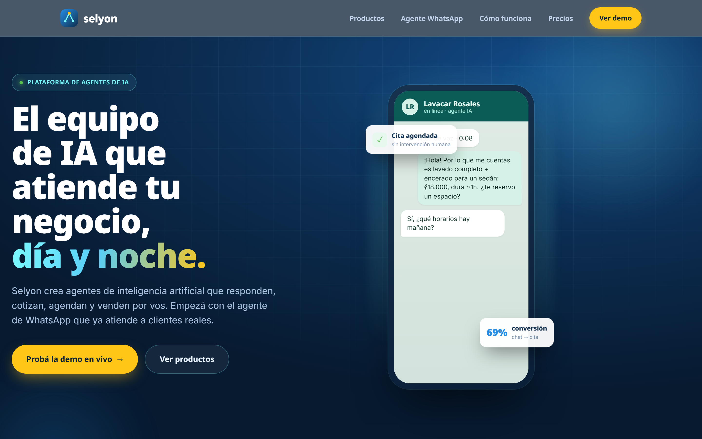

**Qué sabe hacer el agente:**

- **Responder consultas** sobre servicios, precios, horarios y ubicación, con la base de conocimiento propia del negocio.
- **Cotizar** según el vehículo y el servicio (incluso cotizar a partir de una **foto** que envía el cliente, usando visión).
- **Agendar, reprogramar y cancelar citas**, validando disponibilidad y horario real del negocio, con sincronización a Google Calendar.
- **Mensajes interactivos nativos de WhatsApp** — ofrece los horarios libres como una **lista tocable** y usa **botones** de confirmación.
- **Recordatorios con confirmación** (anti no-show): el día antes y el mismo día, con botones *"Confirmo ✅ / Reprogramar"*.
- **Notas de voz** — transcribe el audio del cliente (Whisper) y responde igual que a un texto.
- **Seguimiento post-servicio** — horas después de la cita pregunta *"¿Cómo te fue?"*; si algo salió mal, intercepta al cliente antes de que deje una reseña negativa y avisa al operador; si todo bien, le pide una **reseña de Google**.
- **Escalada a humano** — cuando no puede resolver algo (un reclamo, un caso especial), pasa la conversación a una persona del equipo y la notifica, en vez de improvisar.
- **Consentimiento de marketing explícito** — tras una cita en la que el cliente respondió que le fue bien, el bot le pregunta UNA vez, con botones *Sí / No*, si quiere recibir promociones (el negocio también puede pedirlo desde el chat). Solo quien toca *Sí* recibe campañas.
- **Opt-out real** — el cliente escribe *"BAJA"* (o *"stop"*, *"cancelar suscripción"*, *"no me manden más"*…) y deja de recibir campañas de marketing (los mensajes de servicio siguen).

En la bandeja, una conversación real del bot cerrando una cita se ve así:

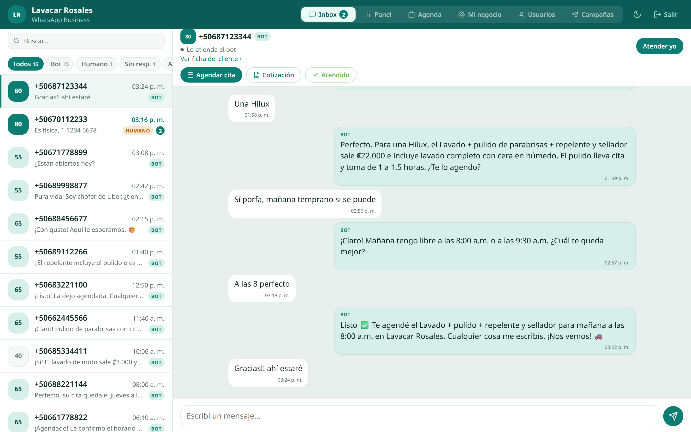

---

## 2. Bandeja / Inbox (atención humana)

La pestaña principal del panel. Muestra todas las conversaciones con **lead score**, filtros (*Todos / Bot / Humano / Sin responder / Atendidas*), buscador y estado (bot vs. humano).

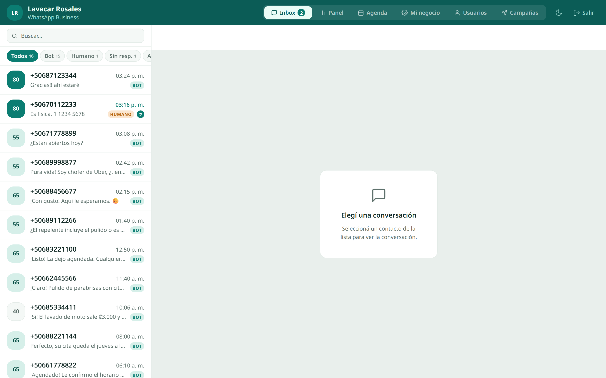

- **Bot ↔ humano** — el operador puede tomar el control de cualquier chat con *"Atender yo"*; un mensaje nuevo del cliente reabre automáticamente la conversación.
- **Acciones rápidas** — *Agendar cita*, *Cotización*, *Atendido* directamente desde el chat.
- **Fotos en el chat** — las imágenes que manda el cliente se ven inline.
- **Cola de trabajo real** — marcar *Atendido* persiste el estado; hay filtro de atendidas y botón de reabrir.

El panel es una **PWA responsive** y funciona igual desde el celular:

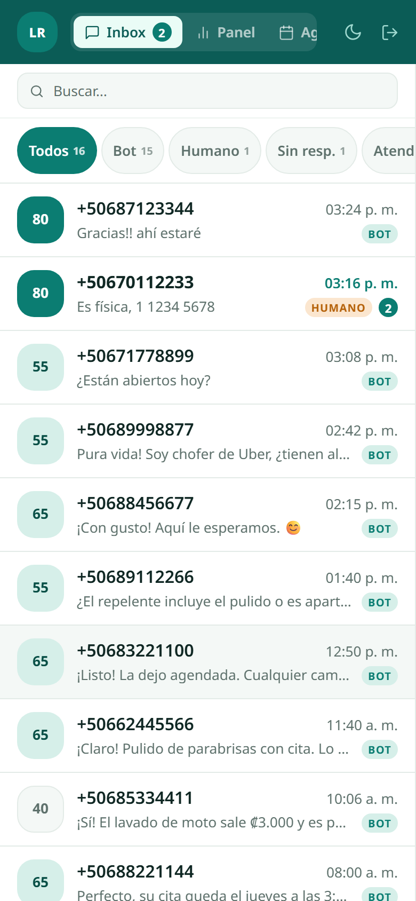

---

## 3. Ficha del cliente (CRM)

Un modal con el historial completo de cada cliente: teléfono, vehículos, total de citas, última visita, **historial de servicios** y **notas privadas** del equipo.

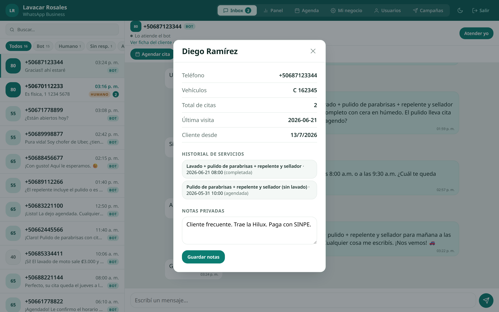

---

## 4. Agenda

Vista de citas por **día** y por **semana**, con acciones sobre cada cita (confirmar, reprogramar, completar, cancelar, marcar no-show).

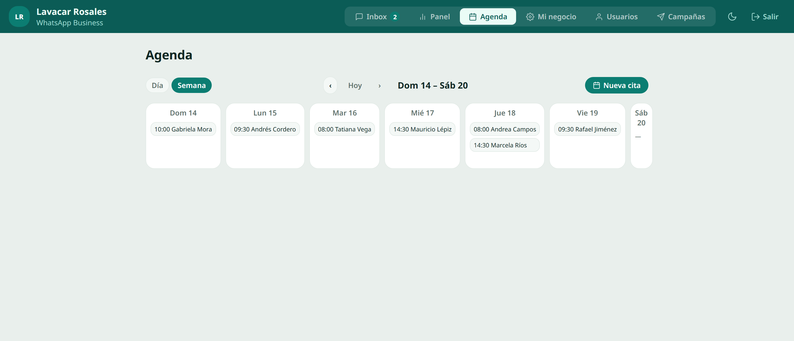

**Cita manual:** el operador puede agendar a mano desde el panel; el selector de hora muestra los espacios libres y los ocupados, y refleja la cita a Google Calendar igual que el bot.

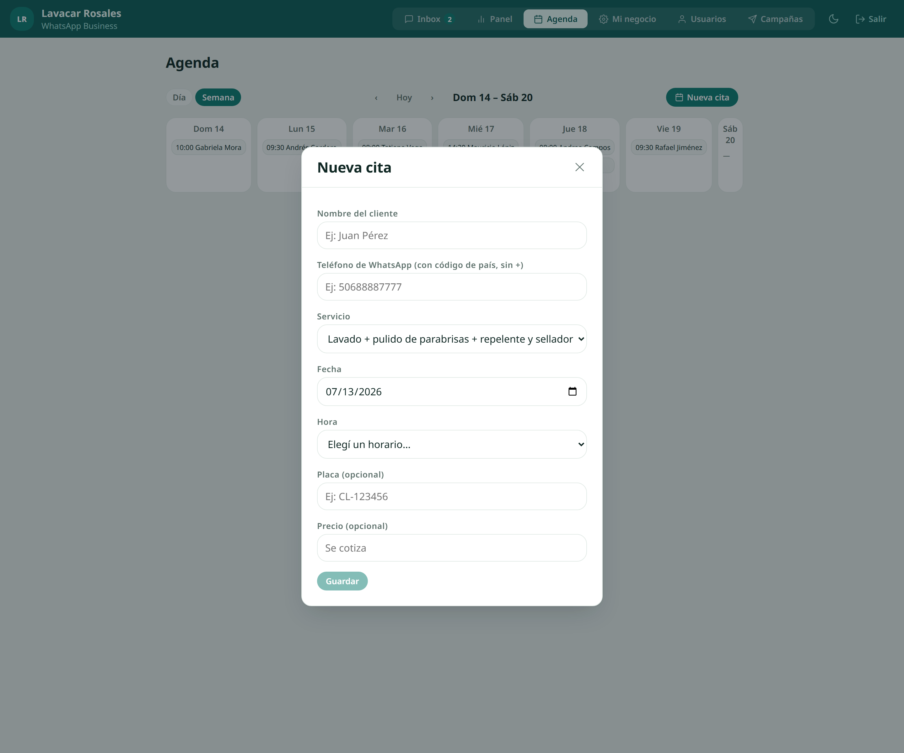

---

## 5. Dashboard del dueño

KPIs del negocio de un vistazo: conversaciones, citas, conversión, ingresos estimados, **"ahorro del bot"** (% de conversaciones resueltas sin humano — el número que justifica la suscripción), **tasa de no-show**, citas por día, servicios más pedidos, horas pico, origen de las citas (bot vs. manuales) y clientes nuevos vs. recurrentes.

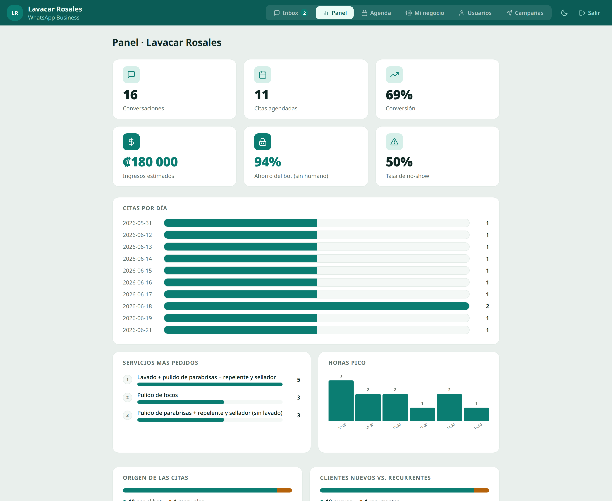

---

## 6. Mi negocio (configuración self-service)

El dueño configura todo su negocio sin depender de soporte: **marca** (logo + colores white-label), **servicios y precios**, **horario** por día, **feriados/bloqueos**, **reseñas de Google**, **plantilla de marketing** y **base de conocimiento** que alimenta al bot. Un solo botón *"Guardar cambios"* y el cambio queda vivo sin redeploy.

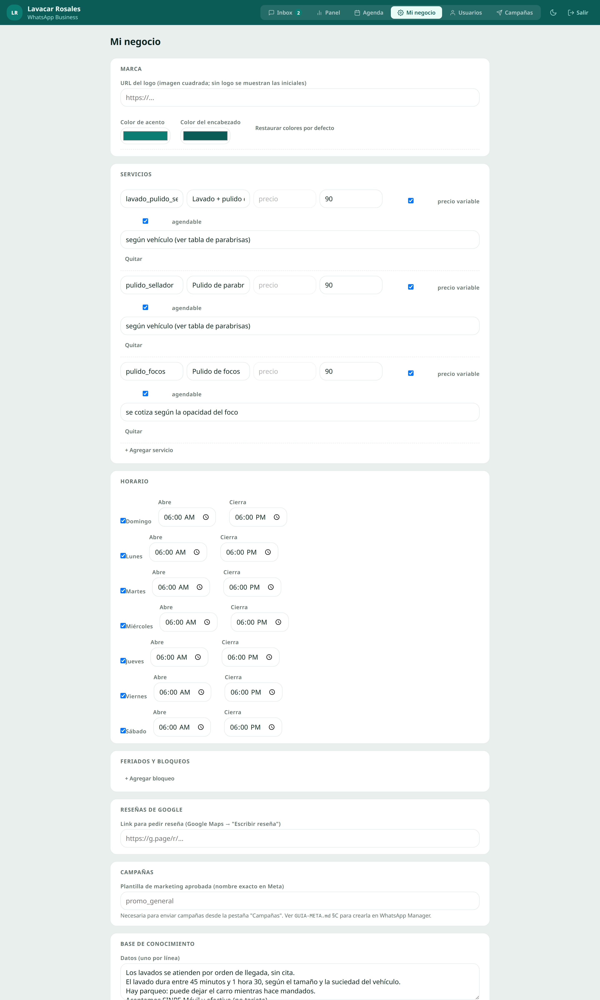

---

## 7. Usuarios (multi-operador y roles)

Pestaña visible solo para el **dueño**. Permite listar, crear y activar/desactivar operadores o dueños adicionales, cambiar su rol, con la garantía de que siempre quede al menos un dueño activo. Los operadores no ven —ni pueden tocar por API— *Mi negocio*, *Usuarios* ni *Campañas*.

> *Esta vista lee directamente de la base de datos de producción, por lo que no se renderiza en el entorno demo local (memoria). La funcionalidad está implementada; el control de roles se aplica tanto en el panel como en el backend.*

---

## 8. Campañas (marketing segmentado)

Pestaña solo para el dueño. Arma un segmento del CRM (*todos*, *inactivos hace N+ días*, *hicieron un servicio hace N+ meses*), previsualiza cuántos clientes califican y envía por una **plantilla de marketing aprobada por Meta**, con throttling propio. **Solo llega a clientes con consentimiento explícito de marketing** (y que no pidieron la baja); la pestaña muestra cuántos clientes dieron permiso y cuántos del segmento quedan afuera por no haberlo dado. Reporta enviados, fallidos, omitidos por opt-out, respuestas y citas generadas.

> *Al igual que Usuarios, esta vista se apoya en tablas de la base de datos de producción y no se renderiza en el demo local. La cola de envío es independiente de la cola principal del webhook para no arriesgar la fiabilidad del sistema.*

---

## 9. Onboarding y administración (SaaS)

Área de superadmin en `/panel/admin`, con sesión aparte de la del operador, para dar de alta nuevos negocios.

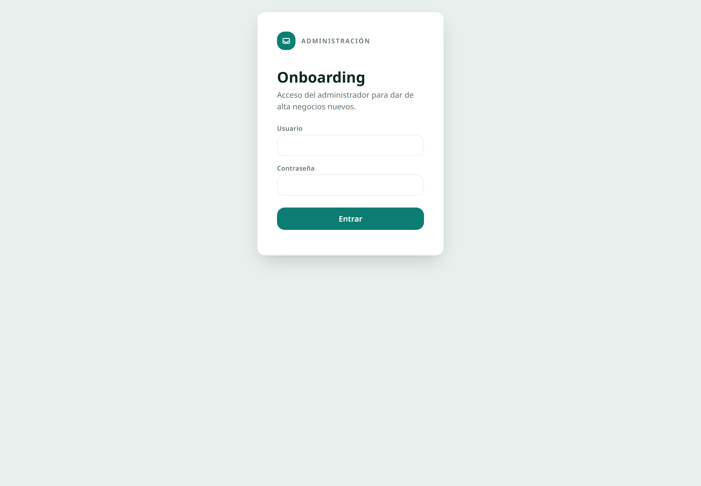

El formulario de alta captura todos los datos del negocio (datos, WhatsApp, horario, servicios agendables, base de conocimiento, usuario del panel) y lo deja operativo **sin redeploy**. Incluye la opción **"Conectar WhatsApp con Meta"** (Embedded Signup) para vincular el número self-serve.

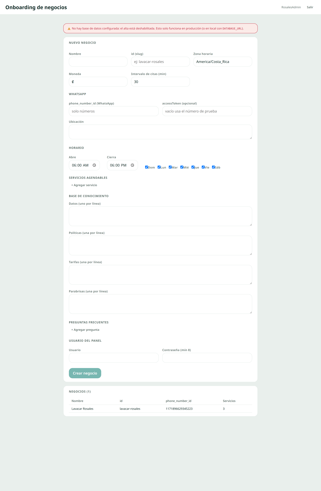

> *En el demo el alta aparece deshabilitada porque no hay base de datos conectada; en producción crea el negocio en caliente.*

---

## 10. Landing de venta (Selyon)

El dominio raíz sirve la landing pública: hero con demo de chat animado, suite de productos, features reales, capturas del panel, planes, FAQ y CTAs a WhatsApp. Incluye páginas de **privacidad** y **términos** (requisito de Meta).

---

## Notas técnicas (resumen de arquitectura)

- **Backend** en TypeScript sobre `node:http` (sin framework), **OpenAI**, **Drizzle + Postgres (Supabase)** y **Google Calendar**.
- **Multi-tenant**: cada negocio (tenant) tiene su config, número de WhatsApp, usuarios y datos aislados.
- **Panel** en React + TypeScript + TanStack Query, servido como **PWA** con notificaciones push.
- **Fiabilidad**: cola durable en Postgres (los mensajes sobreviven a un reinicio), recordatorios seguros para múltiples instancias, Sentry, monitor de uptime, backups y pipeline de CI/CD.
- La costura panel ↔ backend es la API JSON `/api/panel/*`.

*Documento generado el 2026-07-13. Las capturas viven en [`docs/capturas/`](capturas/).*
